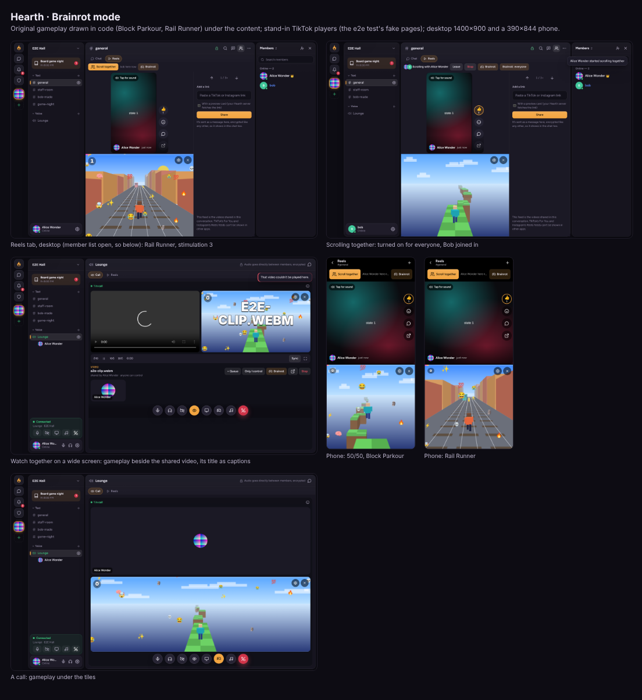

# Brainrot mode

"Gen Z core" meme mode: the video on top, and gameplay that plays itself underneath, with as much extra
stimulation stacked on as you ask for. It can be turned on in three places: the **Reels tab**, the **watch-together
player** and a **call**.

Code: `public/js/brainrot-games.js` (the two games, the flash limiter and the checks: no page, loaded as it is by the
tests), `public/js/brainrot.js` (the surface: the split, the loop, the extras, the settings, the warning, sounds),
`public/css/brainrot.css`. Hooks: `reels-ui.js` (the tab's bar and `.reels-main`), `watch.js` (the player's actions
and `.wt`), `app.js` (`callBrainrot`, the call's round button), `server/reels.js` (`reels:brainrot`). Tests:
`test/brainrot.test.js`, e2e › brainrot mode.

## What it looks like

- **The split.** The content stays where it is and only gets smaller (a moved player would reload): the Reels feed,
  the watch-together video or the call's tiles on top, the gameplay below. On a phone it's half and half, one above
  the other. On a wide screen the Reels tab and watch together put the gameplay beside the video instead (the Reels
  tab from 640 px when it's about as wide as it is tall, so half still fits an upright video; watch together from
  900 px); a call always has it below.
  Watch together's mini player and full screen don't show it (it pauses).
- **The gameplay** is one of:
  - **Block Parkour**: a blocky runner, seen from behind, jumping across floating blocky platforms with a checkered
    top. Short platforms after long gaps are near-misses (their edge glows). The colour theme cross-fades every 14
    platforms (meadow, dusk, neon, candy, snow).
  - **Rail Runner**: three lanes seen from behind the runner, between two rows of blocky buildings. Obstacles come in
    waves: in each, one lane is clear (with a line of coins) and the others have a train, a low barrier (jumped, with
    coins over it) or a high one (rolled under). The runner plans each wave 9 to 17 m ahead; late plans are
    near-misses. Themes: noon, sunset, night.
  - **Your own background**: a YouTube video, muted and looping (see Privacy).

  Both games are original and drawn in code with canvas 2D and a simple perspective projection: boxes and quads,
  no images, sprites, fonts, music or anything else from anywhere. They play themselves; nothing needs input.
- **Stimulation maxing**, a slider from 0 to 3, stacking:
  0. just the gameplay;
  1. big TikTok-style captions (the preview title of the reel on screen, or the watch-together video's title, a couple
     of words at a time, bouncing in) and a progress bar (through the TikTok or the shared video when its length is
     known, otherwise through the game's current theme or wave);
  2. a score counter that ticks up (landings, dodges, coins, near-misses; reactions add 10), with the combo, and
     emoji rain over the gameplay;
  3. a small screen shake when someone reacts to the reel on screen.

  A milestone (every 10 in a row) flashes the gameplay softly from level 2.
- **Meme sounds** (a deep boom on near-misses and reactions, a coin ding, a three-note horn on milestones, a
  whoosh): synthesized with WebAudio, never recordings. Off unless chosen in the settings, never kept across a reload,
  and the audio context is only made by that click, so nothing ever plays on its own. At most one sound every 90 ms,
  the horn at most every 4 s.
- The settings (⚙ on the gameplay): the game, the YouTube link, the slider, sounds, and (scroll together) "On for
  everyone".

## Safety and accessibility

- **Off by default**, per account and per place (Reels, watch together, call), on this device. The first time it's
  turned on, a warning says what it does (moving gameplay, emoji, captions, shake), that it never flashes more than 3
  times a second, that reduced motion makes it calm, and that Esc or ✕ turns it off. "Not now" leaves it off.
- **Flashes (WCAG 2.3.1)**: every effect that changes a big area's brightness at once (the milestone flash, the shake)
  asks `flashLimiter(3, 1000)` first, which allows at most 3 in any one-second window (both ends counted). Colour
  themes cross-fade over 2 seconds; captions change at most every 0.45 s (white outlined text, small area); coins
  and emoji only move.
- **Reduced motion** (the device's `prefers-reduced-motion` or Settings → Appearance → Reduce motion, followed live):
  the games run at half speed, the rain falls at half speed, captions change every 0.9 s without bouncing, no shake,
  no flash, and the slider stops at 1 (a saved 3 counts as 1).
- **Esc** turns off the one on screen (its settings close first) when focus is on the page or inside its place (the
  Reels feed, the watch-together player, the call). It's left alone when it had something else to do: a dialog,
  menu, sheet or the phone's navigation drawer was open, or focus was in a text field (judged before anything
  handles the key). The **✕** on the gameplay does the same. The bar's **Brainrot** button is a toggle
  (`aria-pressed`).
- The gameplay canvas and the extras are `aria-hidden` (decorative); the settings are a labelled group with a real
  radio group, a range input with `aria-valuetext` naming what each level adds, and a checkbox.

## Performance and battery

- The reduced-motion setting is read once and followed by its change events (not asked every frame). With sounds
  turned on, the audio context is suspended whenever nothing can play (sounds off, the page hidden, no gameplay
  running).
- One `requestAnimationFrame` loop per surface, **only while it's on screen**: an `IntersectionObserver` on the
  gameplay and `visibilitychange` stop it (another tab of Hearth, another app, scrolled away, a mini player, full
  screen). The background video is paused the same way.
- The games are fixed-step simulations (60 steps a second whatever the display's rate; after a pause, at most a
  quarter of a second is caught up), each frame a few dozen filled polygons: about 1 ms a frame for both games on a
  desktop.
- The canvas is at most 1.5 device pixels per CSS pixel and 1280 pixels wide (1 and 720 on a low-power device: 4
  cores or fewer, 4 GB or less, or Data Saver), and if frames keep coming slower than 28 a second for two seconds the
  resolution drops by a fifth, down to half (a 30 Hz screen in power saving isn't "slow").
- Emoji are drawn once each to a small canvas and reused; the emoji rain is a pure function of time (no state).
  The counter, progress bar and captions are only written when they change.
- Turning it off, leaving the tab, ending the call or stopping the video destroys the surface: the loop, observers,
  timers and the background video's frame and listener all go.

## Privacy

- The games load nothing. "Your own background" accepts only a YouTube video link (`youtube.com`, `youtu.be`,
  `youtube-nocookie.com`, the same id rules as link previews); it's kept on this device only. It loads only after a
  tap on a cover saying it comes from YouTube (youtube-nocookie.com), which sees your IP address; that tap counts
  until Hearth is closed or reloaded. The player is watch together's YouTube adapter in background mode (`inert`, so nothing in it takes focus):
  `youtube-nocookie.com/embed/<id>?…&mute=1&loop=1&controls=0…`, sandboxed with only `allow-scripts
  allow-same-origin` (no popups, no full screen, no top navigation), `tabindex=-1`, no pointer events, and its
  commands only go to YouTube's origin.
- Captions are the preview title already in the (decrypted) message, shown with `textContent` (never as HTML), with
  control and invisible characters taken out and at most 160 characters.

## Scroll together

Whoever may move everyone (anyone following when *Everyone controls*; the starter or staff with *Only I control*)
can turn it on **for everyone following** with **Brainrot for everyone** in the bar (or the settings). The session
gains two fields, `brainrot: true|false` and `brainrotBy` (the user id of who turned it on, so the note names the right
person), set with `reels:brainrot { key, on }` (only `true` turns it on; at most one switch every 2 seconds per
conversation, so it can't be flickered) and starting `false` with every new session. It carries no game, link, title
or setting: each person's own settings decide what they see.

- Someone who has been warned before (on this device) gets it straight away, with a note: "alice turned on Brainrot
  mode for everyone. Esc turns it off for you."
- Someone who hasn't sees "alice turned on Brainrot mode · Join in · No thanks" in the bar; **Join in** shows the
  warning first. Joining in is for that session only: it isn't left on for next time.
- Anyone can turn it off for themselves (Esc, ✕, the toggle); that choice (like Join in or No thanks) lasts until the
  session ends, even if it's turned off and on again, or they leave and rejoin. People who left the session
  (scrolling on their own) don't get it.

| Event | Who | Carries |
|---|---|---|
| `reels:brainrot` `{ key, on }` | someone following who may control; one switch per 2 s | a boolean |

## Not copied

The modes are named and drawn from scratch: no game, show or app footage, sprites, music, sounds or trademarks are
used anywhere in the code, assets or interface. The emoji are the device's own.
