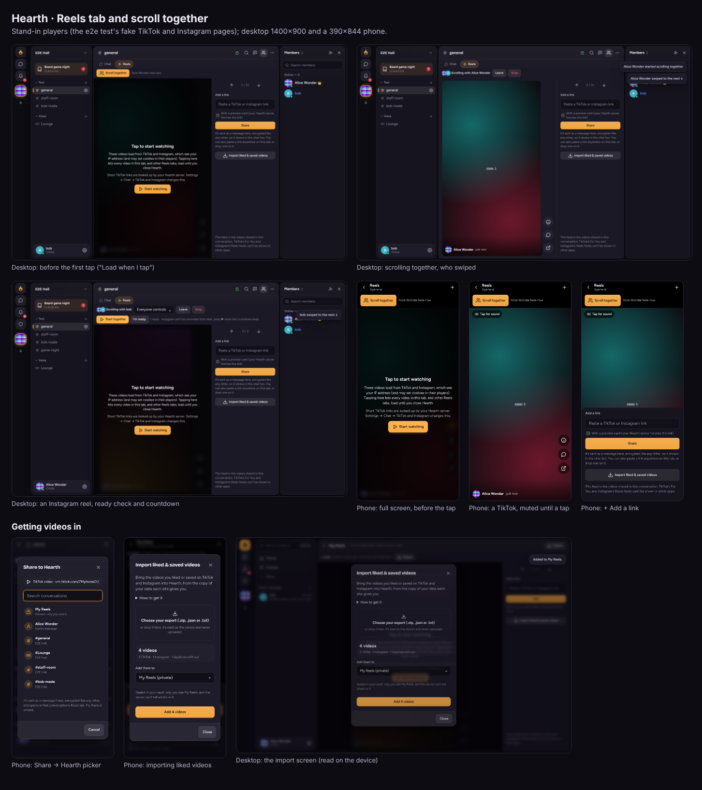

# The Reels tab, and scrolling together

Every text channel, DM, group chat and voice channel chat has a **Reels** tab next to **Chat** (**Call** on a voice
channel's page). It's a full-height, upright feed of every TikTok video and Instagram reel or post shared in that
conversation, newest first, that you swipe through like TikTok, on your own or **together** with everyone else
looking at it.

Code: `public/js/reels.js` (the feed and the rules, no page), `public/js/reels-ui.js` (the tab), `server/reels.js`
(the `reels:*` events), `public/js/app.js` (`convTabs`, `reelsHost`, `REELS`). It reuses `social.js` (which links
count; [SOCIAL-EMBEDS.md](SOCIAL-EMBEDS.md)) and watch together's TikTok and Instagram players (`watch.js`).
Tests: `test/scroll-together.test.js`, e2e › reels tab.

## What it can't be

**TikTok's For You feed and Instagram's Reels feed can't be shown.** Neither offers a way to embed them, and their
terms forbid copying them. The tab says so, and its feed is only the videos people share in the conversation.

## The feed

- Made on each device from the **decrypted** messages: the server can't read them and never learns which links
  they hold. First the messages the chat already has, then older pages (`GET …/messages?before=`), decrypted here,
  asked for as you get within 4 videos of the end (a few pages at a time).
- Each video once (from its newest share), at most 4 from one message, never from thread replies, code or spoilers.
  Left out like in the chat: messages you can't read, gone ones, from people you blocked, ones the word filter hides
  or blurs, and from someone without the Embed links permission.
- Live: a new link goes on top, an edit or delete updates it, reactions update in place.
- Each card: who shared it and when, the sender's preview title if there is one, the message's reactions (tap to
  react, or pick an emoji), **Jump to message** (back to the chat, at the message), and **Open on TikTok/Instagram**.
- **Add a link** (the + on a phone, the side column on a desktop): it's sent as an ordinary message in the
  conversation, encrypted like any other, so it shows in the chat too. A preview card is added if you tick it (your
  server fetches the link, as with any preview); ticked by default when Settings → Chat → "When I send a link" is
  Always. People who can't post there see why instead.

## Swiping

- One video per screen, snapping (`scroll-snap-type: y mandatory`): swipe, the mouse wheel, ↑/↓ (or j/k, Page Up/Down)
  and the side column's arrows.
- The video on screen plays straight away, **without sound** until a tap on its **Tap for sound** button (or m);
  from then on the tab plays with sound. Instagram's player can't be started from outside: its card says to press ▶.
- **Memory:** only the video on screen and one on each side have a player; a player that leaves that window is
  destroyed (its frame removed) and its card goes back to a placeholder. Short TikTok links are looked up (by your
  server) only for the video on screen.
- On a phone (the phone layout) the tab covers the whole screen, with ← back to the chat, the together bar and + at
  the top, and the actions on the right of the video. On a desktop it fills the main column, with a side column.
  The tab is one fixed layer laid over its place, never moved, so the app redrawing around it doesn't reload players.

## Privacy

Settings → Chat → TikTok and Instagram applies:

- **Load when I tap** (default): a cover says the videos load from TikTok and Instagram, which see your IP address,
  and that short links are looked up by your server. **A tap on that cover** lets every video in the tab, and in
  other Reels tabs, load **until you close or reload Hearth**: you don't tap each video. Nothing else counts as
  that tap (not Back, +, or starting a swipe).
- **Always load**: no cover.
- **Just show the link**: cards with the link only, never a player.

Players are `social.js`'s: built from a checked id, on `www.tiktok.com` or `www.instagram.com` only, sandboxed, no
referrer.

## Scroll together

**Scroll together** starts a session for everyone viewing that conversation's Reels tab. Everyone in the
conversation's call who isn't on the tab is told ("alice started scrolling together in …").

- Whoever is following moves everyone: when one person swipes, everyone's tab moves to the same video, and the others
  see "alice swiped to the next ↓". The bar shows "Scrolling with alice, bob" with their pictures.
- **Everyone controls** (default) or **Only I control** (the starter's choice). With Only I control, scrolling away
  means scrolling on your own ("You're scrolling on your own now").
- **Leave** to scroll on your own (kept through a dropped connection); **Rejoin** snaps back to where everyone is.
  Opening the tab during a session joins it; leaving the tab leaves it. The last person following ends it, and so
  does **Stop**. If the starter of an "Only I control" session leaves, everyone controls it from then on.
- Moves are at most one every 0.7 s per conversation (a flood of swipes would reload everyone's players), and the
  "who swiped" note shows at most every 2 s.
- A video shared again is the same card (and player): a session on its older share still finds it.
- The chat isn't on screen on the Reels tab, so messages arriving there stay unread (and notify as usual) until you
  go back to **Chat**.
- **TikTok** stays in step with watch together's sync: play, pause and seeks in the player go to everyone, and each
  player is kept where everyone is (a jump over 1.6 s is corrected).
- **Instagram** can't be controlled: **Start together** shows a 3-second countdown on everyone's screen, then
  "▶ Press play now", with **I'm ready** and a ready count, as in watch together.

### What the server sees

The events carry only **the message id** (a message of that conversation, checked; not a thread reply, and not one
from before your history starts) and **which link in it** (0 to 3), plus play/pause/time. Never a link or any text:
the links stay inside the encrypted messages. So the server learns which message the group is looking at, and when,
but not what it links to (watch together, by contrast, sends the link itself).

| Event | Who | Carries |
|---|---|---|
| `reels:join` `{ key }` | anyone who can read the conversation (a channel they can view, a DM they're in and haven't blocked) | `c:<channelId>` or `d:<dmId>` |
| `reels:leave` | | |
| `reels:start` `{ key, mid, i, hostOnly }` | a viewer, when there's no session | message id, link index |
| `reels:go` `{ key, mid, i, dir }` | someone following who may control | message id, link index, direction |
| `reels:control` `{ key, mid, i, action, position, together }` | the same | play / pause / seek, seconds (capped at 24 h) |
| `reels:ready` `{ key, mid, i, ready }` | someone following | |
| `reels:follow` `{ key, on }` | someone viewing | leave / rejoin |
| `reels:mode` `{ key, hostOnly }` | the starter (or staff) | |
| `reels:stop` `{ key }` | the starter, staff, or anyone following when everyone controls | |

The server answers with `reels:state` to the viewers: `{ key, viewers: [user ids], session: { by, hostOnly, mid, i,
playing, position, updatedAt, startAt, seq, lastBy, lastAction, dir, following, ready }, serverNow }`. Access is
checked on every event, and again for every viewer before each update goes out: someone who loses access (removed,
a channel made private) stops hearing and is let go. Someone for whom the shared message is from before their
history starts isn't sent the session at all. One tab per connection, 200 viewers per conversation, updates
merged to at most 4 a second, and every event counts against the realtime flood limits. Nothing is stored.

## Getting videos in

Copying links by hand is the slow way. Faster ones, all ending in an ordinary encrypted message (or My Reels):

| From | How | Where it lands |
|---|---|---|
| **The Android app** | Share → Hearth on a TikTok or Instagram video (an `ACTION_SEND text/plain` intent filter) | the share picker |
| **Chrome on Android**, Hearth installed as a web app | Share → Hearth (the manifest's `share_target`: `GET /share?url=&text=&title=`) | the share picker |
| **A computer** | the **Send to Hearth** bookmarklet (Settings → Reels): opens `/share?url=<the page you're on>` | the share picker |
| **Any Reels tab** | Ctrl/⌘+V anywhere (not in a text box), or drop a link on it | added after 4 s, with **Undo** |
| **The desktop app** | when the tab opens, a TikTok/Instagram link you copied is *offered* ("Add the TikTok video you copied?") | the tab |
| **Your TikTok/Instagram data download** | Settings → Reels → Import (or Import on a Reels tab / My Reels) | My Reels, or a conversation |

**iPhone and iPad can't do either share target:** iOS doesn't let a web page (or an installed web app) receive
shares, and there's no native iOS app. Copy the link and paste it on a Reels tab instead.

### The share picker

`/share` is the app's own page; it takes the link out of `url`, `text` or `title` (share sheets use any of them),
keeps only a TikTok or Instagram link (`share.js`, social.js's rules) in social.js's own form, puts the address bar
back to `/`, and (after sign-in, if needed) shows **Share to Hearth**: My Reels first, then the conversations you used
recently, then your DMs, group chats and the channels you may post in, with search. Nothing is sent until you pick
one; then the link goes as an ordinary encrypted message (with a preview card if "When I send a link" is Always) and
that conversation's Reels tab opens. Anything else that arrives (another app's junk, a link to another site, a
broken address) shows "Nothing to share" and sends nothing.

The Android app (`mobile/native/ShareLinks.java`) takes only an https link on TikTok's or Instagram's own names
(no user name, password or other port, a plain path) from the shared text, and hands only that, quoted, to the
server's page (`hearth-share`, or `/share?url=` for an older page), which checks it again. Any app can send Hearth
anything; the worst it can do is open the picker with a TikTok or Instagram link in it.

The bookmarklet is `javascript:void(window.open("https://<server>/share?url="+encodeURIComponent(location.href),'_blank','noopener'))`:
it reads the page's address and opens a Hearth tab. It adds nothing to the page and reads nothing else.

### Importing liked and saved videos

From TikTok's **Download your data** (JSON: `user_data_tiktok.json`, Activity → Like List / Favorite Videos; or
the TXT files) and Instagram's **Download your information** (`likes/liked_posts.json`, `saved/saved_posts.json`,
or the HTML version), as the .zip or the files in it (`reels-import.js`).

- **Read on the device; never uploaded.** The e2e test checks that no request carries the file.
- **Untrusted input:** 200 MB at most in all, 64 MB per file unpacked (a .zip entry that unpacks further is
  stopped and skipped), 5,000 .zip entries, 3,000,000 JSON values, depth 64, 10,000 videos. JSON goes through
  `JSON.parse` and is walked without recursion; the structure isn't relied on (every string is searched for
  links), so a format change doesn't break it. Text and HTML are only searched. Only `.json`, `.txt` and `.html`
  inside a .zip are read; Zip64, encrypted entries and other compression methods are skipped. Short links are left
  out (they can't be checked without asking TikTok). TikTok's `tiktokv.com/share/video/<id>` links become TikTok's
  own form.
- It shows how many videos (TikTok, Instagram, duplicates left out), then adds them to:
  - **My Reels** (all of them), or
  - **a conversation**: the newest 100, 4 links to a message (what the feed shows from one message), one message
    every 1.5 s (well within the server's 30-per-10-s limit), stopping with the reason if posting there isn't
    allowed (slowmode, a timeout, a block).

### My Reels

A private feed (Home → My Reels, Settings → Reels, or "My Reels" in the picker): videos you share to yourself or
import. It's kept in your **vault** (`my-reels.js`, `server/myreels.js`): sealed on your device with your personal
vault key (only your identity key makes it), numbered and padded to 16 KB steps, stored as ciphertext
(`GET/PUT /me/reels`, at most 512 KB sealed, 5,000 videos), and synced to your devices (`myreels:changed`). The
server can't tell which videos are in it, or how many beyond the padded size. Each device keeps the newest sealed
copy it opened, so a server handing back an older one can't bring back what you removed; a save that races another
device's is refused as stale and made again on top of it. Each card has **Share to…** (the picker) and **Remove**.
No scroll together there (it's yours alone).

## Limits

- The feed is only what's been shared; videos from long ago appear as you scroll back (each page is decrypted on
  the device).
- Instagram: no play, pause or time from outside.
- Someone whose feed differs (they blocked the sharer, or the message is hidden for them) is told "Everyone moved to
  a video that isn't here for you".
- Leaving the tab (going to the chat or elsewhere) leaves the session; there's no mini player for it.
